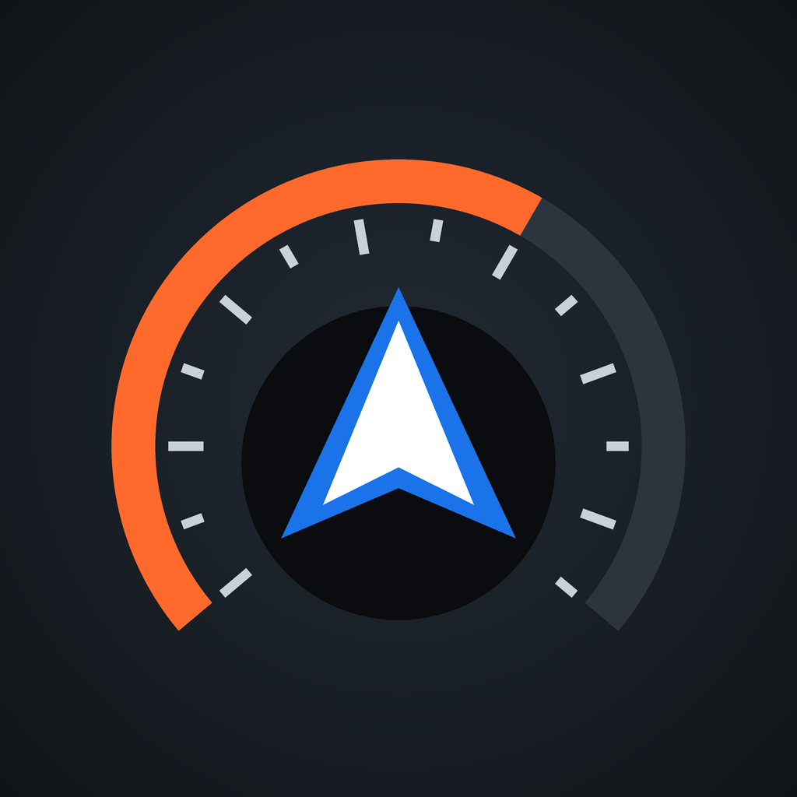
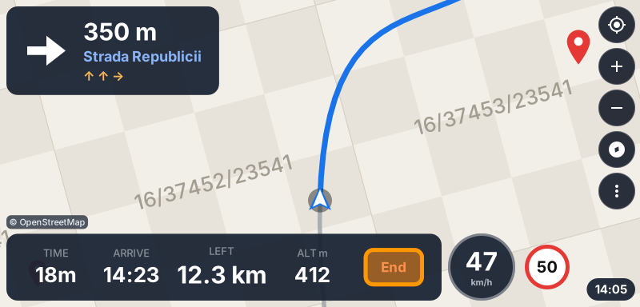
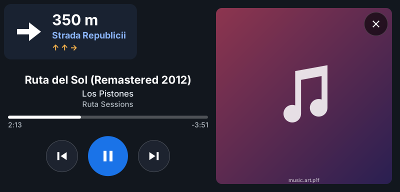
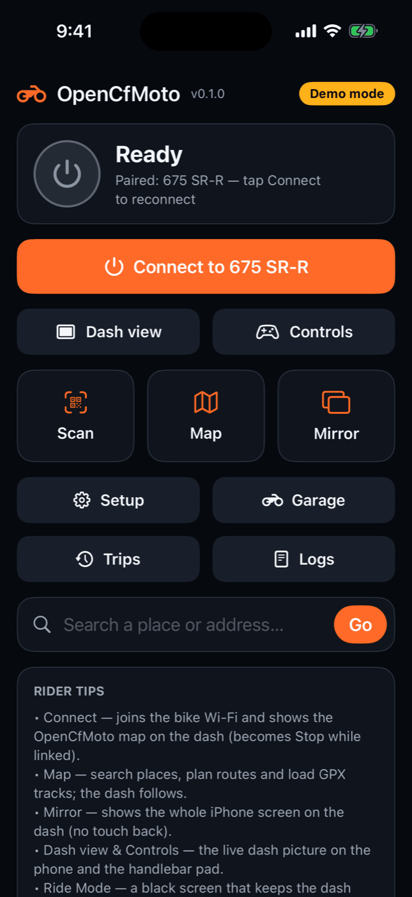
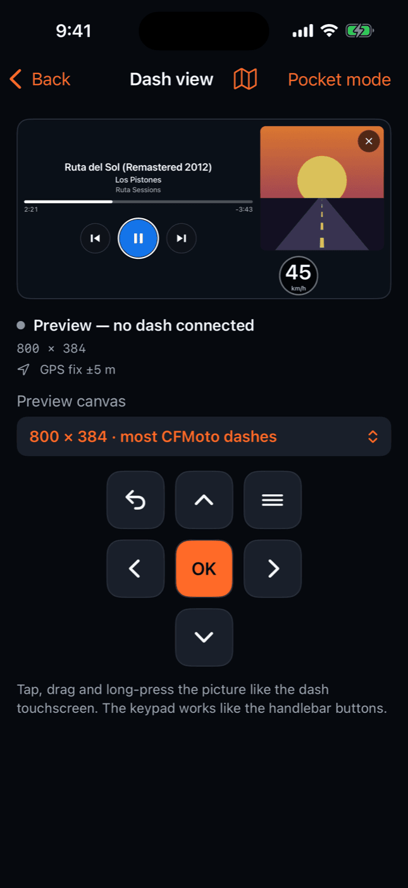
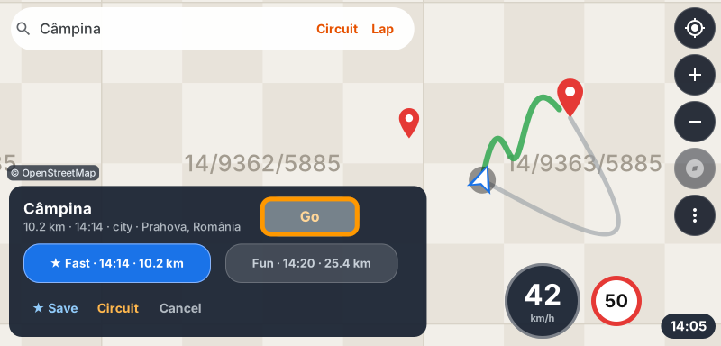

<div align="center">



# OpenCfMoto for iOS

**CFMOTO / MotoPlay dash navigation from your iPhone.** Your own map, turn-by-turn guidance and Apple
Music on **CFMOTO MotoPlay** and other **Carbit / EasyConnect** motorcycle dashboards, streamed over
the bike's Wi-Fi. A **CarPlay alternative for motorcycles**: 450MT · 800MT · 450SR · 675SR-R · 700MT ·
1000MT-X · 800NK · Voge · Moto Morini · QJ Motor…

**Navegación en el tablero de tu CFMOTO / MotoPlay desde el iPhone.** Mapa propio, indicaciones giro a
giro y Apple Music en los tableros **CFMOTO MotoPlay** y otros **Carbit / EasyConnect**, por el Wi-Fi de
la moto. Una **alternativa a CarPlay para motos**.

[](https://github.com/Kevinparra535/opencfmoto-ios/actions/workflows/ci.yml)
[](LICENSE)
[](#requirements)
[](https://www.swift.org)
[](https://github.com/zanderp/open-cfmoto)



<br/>




<sub>Simulator and dash snapshot-test images, demo data only · Capturas del simulador y de las pruebas del tablero, solo datos de demostración</sub>

### [Try it](#try-it) · [Pruébala](#pruebala) · [Credits / Créditos](CREDITS.md) · [English](#opencfmoto-for-ios-english) · [Español](#opencfmoto-para-ios)

</div>

> **Early field testing (v0.1).** Community project, not affiliated with CFMOTO, Carbit or Apple. Set
> your route before you ride. · **Pruebas de campo (v0.1).** Proyecto comunitario, sin afiliación con
> CFMOTO, Carbit ni Apple. Fija la ruta antes de salir.

---

# OpenCfMoto para iOS

**OpenCfMoto para iOS** es una app de iPhone que envía su **propia interfaz de navegación** —mapa,
indicaciones giro a giro, velocidad, límite de velocidad, hora de llegada, reloj y menús— a los
tableros **Carbit / EasyConnect** de las motos (CFMoto **MotoPlay** y sus hermanos de otras marcas),
usando el protocolo **PXC** obtenido por ingeniería inversa. Es un port a Swift de la app Android
[OpenCfMoto](https://github.com/zanderp/open-cfmoto) (AGPL-3.0), concretamente de su modo
«Mapa / GPX en el tablero».

> ⚠️ Proyecto comunitario en desarrollo (v0.1). Todavía no se ha probado en todas las motos:
> los informes de campo (con registros) son lo más valioso que puedes aportar.

<a id="pruebala"></a>
## Pruébala

- **En tu iPhone, sin Mac y gratis**: instala la versión para sideload
  (`OpenCfMoto-vX.Y.Z-sideload.ipa`, en [Releases](https://github.com/Kevinparra535/opencfmoto-ios/releases))
  con SideStore, AltStore Classic o Sideloadly y un Apple ID gratuito. Te unes tú al Wi-Fi de la moto
  desde Ajustes (la app te da el nombre y la contraseña, con un botón para copiarla; la copia dura 2
  minutos) y hay que renovarla cada 7 días. Paso a paso: [docs/INSTALAR.md](docs/INSTALAR.md).
- **Todo, también sin Mac**: haz un fork de este repositorio y compila tu propia copia en TestFlight con
  GitHub Actions (cuenta de pago de Apple Developer, 99 USD al año) →
  [docs/TESTFLIGHT.md](docs/TESTFLIGHT.md).
- **Con un Mac**: compílala con Xcode (cuenta gratuita: 7 días; de pago: hasta un año) →
  [Compilar e instalar](#compilar-e-instalar).
- **Sin moto**: el modo demostración en el Simulador de iOS (argumento `-demo`, más abajo) o, en el
  iPhone, Inicio ▸ **Vista de tablero**, que dibuja la pantalla del tablero sin tablero.
- **¿Tienes Android?** Usa la app original,
  [OpenCfMoto para Android](https://github.com/zanderp/open-cfmoto/releases/latest) (el APK está en su
  página de Releases).
- Cuéntanos cómo te fue con un
  [informe de campo](https://github.com/Kevinparra535/opencfmoto-ios/issues/new?template=field-report.yml).

## Qué hace

- **Mapa propio en el tablero**: el iPhone dibuja la pantalla del tablero (CoreGraphics), la
  codifica en H.264 (VideoToolbox) y la envía por el Wi-Fi de la moto. Teselas de OpenStreetMap,
  modo día/noche, ruta, cartel de giro con distancia, carriles, métricas (tiempo, llegada,
  distancia restante, altitud) y límite de velocidad.
- **Navegación**: búsqueda de lugares y direcciones, categorías cercanas (gasolina, café, comida,
  aparcamiento, hotel, cajero, hospital, mirador), rutas alternativas (Rápida / Divertida),
  circuito de ida y vuelta, evitar peajes o autovías, seguimiento de pistas **GPX**, recálculo,
  avisos de voz en español o inglés, favoritos, marcadores, casa y «dónde aparqué».
- **Táctil del tablero** (en los tableros táctiles) y **botones del manillar** (opcional y
  experimental, a través de los controles multimedia del iPhone), con asignación de gestos,
  preajustes por piña de mandos y lugares guardados para navegar con un botón.
- **Apple Music en el tablero** (opcional, Ajustes): la portada de la canción que suena en la app
  **Música** sobre el mapa y, al tocarla, una hoja con título, artista, progreso y ⏮ ⏯ ⏭, sin tapar
  nunca la indicación de giro. También con los botones del manillar. Solo Apple Music: iOS no deja
  que una app vea lo que suena en Spotify, YouTube Music u otras.
- **Viajes**: ordenador de viaje, registro automático de cada ruta mientras el tablero muestra el
  mapa, lista por días con miniaturas y exportación **GPX**.
- **Garaje** con varias motos (cada una con sus propios ajustes), **conexión automática** y
  **recuperación** del enlace, **modo espejo** (toda la pantalla del iPhone en el tablero) y
  **registros** con informe de problemas (contraseñas y números de serie ocultos).
- **Ajustes compatibles con Android**: los paquetes `opencfmoto.settings` y `opencfmoto.map`
  se importan y exportan en el mismo formato que la app Android.
- Interfaz en **español e inglés** (sigue el idioma del iPhone).

## Motos y tableros compatibles (CFMOTO 450MT, 800MT, 450SR…)

Cualquier tablero CFMoto MotoPlay / EasyConnect u otro tablero del entorno Carbit que muestre un
**QR de emparejamiento**; no hace falta T-BOX. Estas motos están confirmadas con la app Android
(el protocolo y los perfiles de tablero son los mismos en iOS):

- **CFMoto**: 800MT (MT-X / Explore / Explore GT / Ibex 800) · 1000 MT-X · 800NK (US, CRCP) ·
  800NK Advanced · 675NK · 675SR-R · 700MT Adventure · 450MT · 450SR (+ SR-S / TC) ·
  450CL-C / CL-C450 · 450NK · 150SC · CFORCE 850 / 1000 · GOES Terrox 1000 / Gladiator G3 1000.
- **Otras marcas**: Voge DS800 Rally / DS900X · Moto Morini X-Cape 649 / 700 / Seiemmezzo ·
  Benelli TRK 702 / 702X (Wi-Fi introducido a mano, sin QR) · Rieju 307 · Zontes 125X ·
  Morbidelli T1002VX / T352X · QJ Motor SRK800RR / SRK450RR / SRK250RD / SRT 600 / SRV600.

Si tu tablero muestra el QR, prueba a conectar y comparte el resultado. Los tableros que se
conectan al punto de acceso del teléfono (algunos Zontes / Carbit «action=128») no funcionan en
iOS: iOS no permite crear un punto de acceso con el nombre que pide el tablero.

## Cómo funciona

1. **Emparejar**: escaneas el QR del tablero (o introduces el SSID y la contraseña). El QR
   contiene el Wi-Fi de la moto; se guarda en el llavero (Keychain) del iPhone.
2. **Conectar**: la app se une al Wi-Fi de la moto (`NEHotspotConfiguration`), abre los puertos
   10920–10922, envía la sonda a `:10930` y el tablero se conecta de vuelta al iPhone. Tras el
   saludo (`CLIENT_INFO`, firma RSA) el tablero pide fotogramas y la app le envía el vídeo H.264
   de su propia interfaz. Los toques del tablero vuelven a la app y la manejan.
3. **Internet**: el Wi-Fi de la moto no tiene internet. Búsquedas, rutas y teselas van por los
   datos móviles mientras estás unido a la moto (por eso se recomienda una tarifa de datos).

**¿Por qué no Android Auto ni CarPlay?** La app Android retransmite Android Auto, que es un
componente de Android: en iOS no existe. CarPlay solo funciona con unidades certificadas por Apple
(autenticación MFi) y iOS no deja que una app capture o reenvíe el vídeo de CarPlay. Por eso la app
de iOS dibuja **su propia interfaz** de navegación para el tablero, como el modo «Mapa» de Android.

**Modo espejo**: con la extensión de ReplayKit puedes enviar **toda la pantalla del iPhone** al
tablero (por ejemplo, para otra app de mapas). Los toques del tablero no controlan las apps
duplicadas, la pantalla debe estar encendida y la emisión se detiene al bloquear el teléfono.

## Requisitos

- Un **iPhone con iOS 17** o posterior y, para compilarla tú, un **Mac con Xcode 16** o posterior.
  **Sin Mac**: la versión para sideload de [Releases](https://github.com/Kevinparra535/opencfmoto-ios/releases)
  con un Apple ID gratuito ([docs/INSTALAR.md](docs/INSTALAR.md)) o, con la cuenta de pago, GitHub la
  compila y la sube a tu TestFlight ([docs/TESTFLIGHT.md](docs/TESTFLIGHT.md)).
- Una **cuenta de Apple Developer**:
  - **De pago** (Apple Developer Program) para la variante `full`: la app se une sola al Wi-Fi de
    la moto (*Hotspot Configuration*) y lee el SSID actual (*Access WiFi Information*).
  - **Gratuita** (Personal Team) para la variante `free`: sin esos permisos, te unes al Wi-Fi de
    la moto desde Ajustes de iOS cuando la app te lo pide (muestra el nombre y la contraseña, con
    un botón para copiarla; la copia dura 2 minutos). Con una cuenta gratuita la app caduca a los 7
    días (vuelve a instalarla desde Xcode), hay un máximo de 3 apps por dispositivo y la extensión de
    espejo usa otro App ID.
- [XcodeGen](https://github.com/yonaskolb/XcodeGen) para generar el proyecto de Xcode.

## Compilar e instalar

```sh
brew install xcodegen
git clone https://github.com/Kevinparra535/opencfmoto-ios.git
cd opencfmoto-ios
cp Config/Local.xcconfig.example Config/Local.xcconfig
#   edita Config/Local.xcconfig:
#   DEVELOPMENT_TEAM = <tu Team ID>
#   BUNDLE_ID_PREFIX = com.tunombre        (un prefijo que sea tuyo)
#   OCM_FLAVOR       = full                (o free con una cuenta gratuita)
xcodegen generate
open OpenCfMoto.xcodeproj
```

En Xcode elige el esquema **OpenCfMoto**, tu iPhone como destino y pulsa **Run**. Antes, en el
iPhone, activa el **Modo de desarrollador** (Ajustes ▸ Privacidad y seguridad ▸ Modo de
desarrollador; la opción aparece después de conectar el iPhone al Mac con Xcode abierto). Usa el
Xcode más reciente: tiene que ser compatible con la versión de iOS de tu iPhone. Si iOS dice
«Desarrollador no confiable» (pasa con la cuenta gratuita), confía en él en Ajustes ▸ General ▸ VPN
y gestión de dispositivos. Al conectar con la moto, iOS pide permiso de **red local** y de
**ubicación**: acéptalos, sin ellos la app no puede hablar con el tablero ni dibujar el mapa.
`Config/Local.xcconfig` no se sube al repositorio.

Para la prueba en la moto compílala en **Release** (Product ▸ Scheme ▸ Edit Scheme ▸ Run ▸ Build
Configuration ▸ Release), que va más fluida que Debug. Después no necesitas el Mac: abre la app desde
la pantalla de inicio. Con la cuenta de pago la instalación dura hasta un año (con la gratuita, 7 días).

### Sin Mac: TestFlight

Con la cuenta de pago, el workflow **TestFlight** de GitHub Actions compila la app en un Mac en la
nube, la firma y la sube a TestFlight; tú la instalas con la app TestFlight. Solo hay que crear una
clave de la API de App Store Connect, guardarla como secreto en GitHub y hacer dos pasos en la web
de Apple. Guía paso a paso: [docs/TESTFLIGHT.md](docs/TESTFLIGHT.md).

### Modo demostración

Para probar sin moto (por ejemplo en el **Simulador**), añade el argumento de arranque `-demo`
(Xcode ▸ Product ▸ Scheme ▸ Edit Scheme ▸ Run ▸ Arguments). La app usa servicios simulados: sin
Wi-Fi ni tablero, con una ruta GPS de demostración para ver la interfaz del tablero en el teléfono.

### Primera prueba en la moto

Sigue la guía paso a paso [docs/PRUEBA-EN-LA-MOTO.md](docs/PRUEBA-EN-LA-MOTO.md): qué esperar en cada fase de la conexión, cómo compartir registros, grabar el vídeo enviado al tablero y qué opciones probar si algo falla.

## Limitaciones conocidas

- **Modo ruta en primer plano**: iOS solo garantiza el codificador de vídeo por hardware y el
  Wi-Fi con la app en primer plano. Durante la ruta deja la app abierta en **Modo ruta** (pantalla
  negra, el teléfono no se bloquea) y con el iPhone cargando.
- **Teléfono bloqueado**: en segundo plano iOS no deja usar el codificador de vídeo por hardware;
  el tablero mantiene una imagen fija («Teléfono bloqueado: desbloquéalo para actualizar el mapa»).
  La build actual es de **diagnóstico**: con el teléfono bloqueado prueba si iOS da un codificador
  por software (si lo da, el mapa sigue moviéndose) y mide en los registros si el proceso, el Wi-Fi,
  el enlace, el GPS y la brújula siguen vivos, y cuánta CPU gasta (guía en
  [docs/PRUEBA-EN-LA-MOTO.md](docs/PRUEBA-EN-LA-MOTO.md)). No promete el mapa en vivo, y el enlace
  solo sigue mientras iOS conserve el Wi-Fi, lo que no está garantizado con la pantalla bloqueada.
  **Modo ruta** sigue siendo el modo fiable.
- **Permiso de red local**: iOS lo pide la primera vez que la app busca el tablero; si lo
  deniegas, actívalo en Ajustes ▸ OpenCfMoto ▸ Red local.
- **Botones del manillar**: solo llegan a la app que está «reproduciendo» (Now Playing). La
  opción es experimental y voluntaria: reproduce audio silencioso y **pausa la música de otras
  apps** mientras está activa; no todos los tableros envían esos botones; la pulsación larga de ★
  no es detectable en iOS; los ▲/▼ de volumen solo funcionan con la opción experimental.
- **Apple Music**: solo la app Música de Apple (ni Spotify ni YouTube Music: iOS no da acceso).
  Mientras suena, los botones ◀ ▶ ★ de la moto controlan la música; con el mando multimedia del
  teléfono activado, pausa la canción con ★ para devolvérselos al tablero.
- **Versión para sideload** (gratuita, de Releases): te unes al Wi-Fi de la moto a mano en Ajustes
  (la app muestra la red y la contraseña, con un botón para copiarla; la copia dura 2 minutos),
  caduca a los 7 días si no la renuevas, entra en el máximo de 3 apps instaladas así y el modo
  espejo puede no estar disponible ([docs/INSTALAR.md](docs/INSTALAR.md)).
- **App Store**: el audio silencioso para los botones y la lectura del volumen podrían no ser
  aceptados en la revisión de Apple. Además, la licencia **AGPL** es difícil de compatibilizar con
  las condiciones de la App Store: distribuir esta app (o un derivado) a otras personas, ya sea en
  la App Store o con pruebas externas o un enlace público de TestFlight, requiere el permiso de los
  titulares del proyecto original. La forma prevista es que cada persona la instale con su propio
  Apple ID: la versión para sideload de Releases, Xcode o las pruebas internas de TestFlight (solo
  para ti). Publicar el IPA en Releases, junto a su código fuente, es una distribución normal bajo la
  AGPL.
- Los servicios públicos de OpenStreetMap (teselas, Photon, Nominatim, Overpass, OSRM, Valhalla)
  tienen políticas de uso justo; para un uso intensivo configura tu propio servidor de teselas o
  una clave de OpenRouteService en Ajustes.

## Estructura del repositorio

```
project.yml                     Especificación de XcodeGen (app + extensión de espejo)
Config/                         OpenCfMoto.xcconfig (+ Local.xcconfig, tuyo, no versionado)
App/Sources/                    App SwiftUI: pantallas en UI/<función>/, servicios iOS en Services/
App/Resources/                  Recursos; Localization/*.json → Localizable.xcstrings (español)
MirrorExtension/                Extensión ReplayKit (modo espejo)
Packages/OpenCfMotoKit/         Paquete Swift
  Sources/OpenCfMotoCore/         Swift puro: protocolo PXC, enlace, navegación, interfaz del
                                  tablero, viajes, ajustes (compila y se prueba en Linux)
  Sources/OpenCfMotoAppModel/     Modelos @Observable de la app (también probados en Linux)
  Sources/OpenCfMotoApple/        Adaptadores de Apple: red, Wi-Fi, ubicación, voz, vídeo, mapa
  Tests/                          Pruebas XCTest
docs/ARCHITECTURE.md            Arquitectura y reglas del proyecto
docs/spec/                      Especificaciones de comportamiento extraídas de la app Android
docs/TESTFLIGHT.md              Instalar sin Mac: compilar y subir a TestFlight desde GitHub
docs/INSTALAR.md                Instalar sin Mac con un Apple ID gratuito (SideStore, AltStore, Sideloadly)
.github/workflows/              ci.yml (pruebas y compilaciones), testflight.yml (TestFlight) y
                                release.yml (IPA para sideload)
tools/                          Herramientas: traducciones, CI, tablero simulado (fakedash)
  testflight/                     App Store Connect (asc.py), firma y subida, revisión del IPA
CREDITS.md, NOTICE, LICENSES/   Créditos, avisos de copyright y licencias de terceros (Apache 2.0)
```

## Pruebas e integración continua

```sh
swift test --package-path Packages/OpenCfMotoKit
```

El núcleo y los modelos de la app (unas mil pruebas) se ejecutan en Linux y macOS. En cada push,
GitHub Actions (`.github/workflows/ci.yml`) ejecuta las pruebas en Linux, las vuelve a ejecutar en
macOS compilando los adaptadores de Apple, genera el proyecto con XcodeGen y compila la app para
el Simulador de iOS y para iPhone (también con el Xcode más reciente). Además ensaya el flujo de
TestFlight sin credenciales: pruebas de `asc.py`, de los pasos de `build_and_sign.sh` y de los
mensajes del workflow contra un App Store Connect simulado, ajustes de firma, archivo sin firmar
revisado por `lint_bundle.py`, el llavero temporal y la limpieza tras una cancelación. Las
traducciones se reúnen con `python3 tools/l10n/build_strings.py`.

## Privacidad

Sin cuentas, sin anuncios y sin telemetría. Las motos, los viajes y los registros se quedan en el
iPhone hasta que tú los compartes; las contraseñas Wi-Fi se guardan en el llavero y se ocultan en
los registros. Las búsquedas, rutas y teselas consultan servicios de OpenStreetMap. Con **Apple
Music en el tablero**, la canción se lee en el iPhone y OpenCfMoto no la envía a ningún sitio (ni
títulos, ni artistas, ni identificadores de canciones en los registros: cada canción aparece con
un código que cambia en cada arranque de la app); la portada de las canciones en streaming la carga
MusicKit de Apple desde los servidores de Apple.

## Preguntas frecuentes

- **¿Funciona con CarPlay?** No. CarPlay solo funciona con unidades certificadas por Apple;
  OpenCfMoto dibuja su propia interfaz de navegación para el tablero MotoPlay / EasyConnect de la
  moto.
- **¿Puedo ver Google Maps o Waze en el tablero de mi CFMOTO con un iPhone?** Con el modo espejo, sí:
  el tablero muestra toda la pantalla del iPhone, pero sus toques no controlan esas apps (en la versión
  para sideload el modo espejo puede no estar disponible).
- **¿Funciona con Android?** Esta es la app de iPhone. En Android usa la app original,
  [OpenCfMoto para Android](https://github.com/zanderp/open-cfmoto), que además retransmite Android
  Auto.
- **¿Está en la App Store?** No: mira [Pruébala](#pruebala).

## Créditos y licencia

Port para iOS de **[OpenCfMoto](https://github.com/zanderp/open-cfmoto)**, de Alexandru Popa
([@zanderp](https://github.com/zanderp)) y los colaboradores de OpenCfMoto, que continúa el trabajo de
la comunidad open-cfmoto: dcoletto / coletz, richardbizik, ionutradu252 / OpenCFLink, eugen0309,
Authoritt (también la traducción al español), BojanJ, Martin Escudero, Glifaus, sashop2001 y los
traductores. El protocolo, los perfiles de tablero, la navegación, los GPX, los viajes y los formatos
de ajustes se han portado de su código Kotlin y de su documentación de ingeniería inversa. El receptor
de Android Auto de la app Android (headunit de Michael Reid y Open Headunit de Andre Rinas) se
acredita, pero no está en esta app. Incluye código traducido de AOSP e iconos Material de Google bajo
la licencia Apache 2.0 ([LICENSES/Apache-2.0.txt](LICENSES/Apache-2.0.txt)). Datos de mapa ©
colaboradores de OpenStreetMap (ODbL), a través de los servicios que se citan en los créditos. Lista
completa: [CREDITS.md](CREDITS.md).

Software libre bajo la **GNU Affero General Public License v3.0 o posterior** (ver
[LICENSE](LICENSE) y [NOTICE](NOTICE)). Si redistribuyes una versión modificada, debes ofrecer su
código fuente completo bajo la misma licencia.

## Aviso

Proyecto comunitario independiente. No está afiliado, respaldado ni patrocinado por CFMOTO,
Carbit, Apple, Google ni ninguna marca de motos. CFMOTO, MotoPlay, EasyConn, Carbit, iPhone,
CarPlay, Android Auto y las marcas relacionadas pertenecen a sus propietarios. Se ofrece **sin
ninguna garantía**: úsalo bajo tu propia responsabilidad, no dependas de él para una navegación
crítica, fija la ruta antes de salir y no manipules el teléfono mientras conduces.

---

# OpenCfMoto for iOS (English)

**OpenCfMoto for iOS** is an iPhone app that streams its **own navigation dash UI** — map,
turn-by-turn guidance, speed, speed limit, arrival time, clock and menus — to **Carbit /
EasyConnect** motorcycle dashboards (CFMoto **MotoPlay** and its siblings from other brands) over
the reverse-engineered **PXC** protocol. It is a Swift port of the Android app
[OpenCfMoto](https://github.com/zanderp/open-cfmoto) (AGPL-3.0), specifically of its
"Map / GPX on the dash" mode.

> ⚠️ Community project, work in progress (v0.1). It has not been tested on every bike yet: field
> reports (with logs) are the most valuable contribution you can make.

## Try it

- **On your iPhone, no Mac, free**: install the sideload build
  (`OpenCfMoto-vX.Y.Z-sideload.ipa`, on [Releases](https://github.com/Kevinparra535/opencfmoto-ios/releases))
  with SideStore, AltStore Classic or Sideloadly and a free Apple ID. You join the bike Wi-Fi yourself
  in Settings (the app shows the network and the password, with a copy button; the copy lasts 2
  minutes), and the app must be refreshed every 7 days. Step by step:
  [docs/INSTALAR.md](docs/INSTALAR.md#english).
- **Everything, still without a Mac**: fork this repository and build your own TestFlight copy with
  GitHub Actions (paid Apple Developer account, 99 USD a year) →
  [docs/TESTFLIGHT.md](docs/TESTFLIGHT.md#english).
- **With a Mac**: build it with Xcode (free account: 7 days; paid: up to a year) →
  [Build and install](#build-and-install).
- **No bike**: demo mode in the iOS Simulator (the `-demo` launch argument, see [Demo mode](#demo-mode))
  or, on the iPhone, Home ▸ **Dash view**, which draws the dash picture without a dash.
- **On Android?** Use the original
  [OpenCfMoto for Android](https://github.com/zanderp/open-cfmoto/releases/latest) (the APK is on its
  Releases page).
- Tell us how it went with a
  [field report](https://github.com/Kevinparra535/opencfmoto-ios/issues/new?template=field-report.yml).

## Features

- **Own map on the dash**: the iPhone draws the dash picture (CoreGraphics), encodes it as H.264
  (VideoToolbox) and sends it over the bike's Wi-Fi. OpenStreetMap tiles, day/night themes, the
  route, the maneuver card with distance and lanes, metrics (time, arrival, distance left,
  altitude) and the speed limit.
- **Navigation**: place and address search, nearby categories (fuel, cafe, food, parking, hotel,
  ATM, hospital, viewpoint), alternative routes (Fast / Fun), there-and-back circuits, avoid tolls
  or highways, **GPX** track following, rerouting, voice prompts in English or Spanish, favorites,
  markers, home and "where did I park".
- **Dash touch** (on touch dashes) and **handlebar buttons** (opt-in and experimental, through the
  iPhone's media remote) with gesture mapping, switch-cluster presets and saved places for
  one-button navigation.
- **Apple Music on the dash** (opt-in, Settings): the cover of the song the **Music** app plays on
  the map and, on a tap, a sheet with title, artist, progress and ⏮ ⏯ ⏭ that never hides the turn
  guidance — handlebar buttons work too. Apple Music only: iOS does not let an app see what Spotify,
  YouTube Music or other players play.
- **Trips**: trip computer, automatic logging of every ride while the dash shows the map, a
  by-day list with route thumbnails and **GPX** export.
- **Garage** with several bikes (each with its own settings), **auto-connect** and **link
  recovery**, **mirror mode** (the whole iPhone screen on the dash) and **logs** with a problem
  report (passwords and serial numbers redacted).
- **Android-compatible settings**: `opencfmoto.settings` and `opencfmoto.map` packs import and
  export in the same format as the Android app.
- **English and Spanish** UI (follows the iPhone language).

## Supported bikes and dashes (CFMOTO 450MT, 800MT, 450SR…)

Any CFMoto MotoPlay / EasyConnect dash, or another Carbit-framework dash that shows a **pairing
QR**; no T-BOX needed. These bikes are confirmed with the Android app (the protocol and the dash
profiles are the same on iOS):

- **CFMoto**: 800MT (MT-X / Explore / Explore GT / Ibex 800) · 1000 MT-X · 800NK (US, CRCP) ·
  800NK Advanced · 675NK · 675SR-R · 700MT Adventure · 450MT · 450SR (+ SR-S / TC) ·
  450CL-C / CL-C450 · 450NK · 150SC · CFORCE 850 / 1000 · GOES Terrox 1000 / Gladiator G3 1000.
- **Other brands**: Voge DS800 Rally / DS900X · Moto Morini X-Cape 649 / 700 / Seiemmezzo ·
  Benelli TRK 702 / 702X (Wi-Fi entered by hand, no QR) · Rieju 307 · Zontes 125X ·
  Morbidelli T1002VX / T352X · QJ Motor SRK800RR / SRK450RR / SRK250RD / SRT 600 / SRV600.

If your dash shows the QR, try Connect and share the result. Dashes that join the *phone's*
hotspot (some Zontes / Carbit "action=128") cannot work on iOS: iOS does not let an app create a
hotspot with the name the dash expects.

## How it works

1. **Pair**: scan the dash QR (or type the SSID and password). The QR holds the bike's Wi-Fi; it is
   stored in the iPhone Keychain.
2. **Connect**: the app joins the bike Wi-Fi (`NEHotspotConfiguration`), opens ports 10920–10922,
   sends the probe to `:10930` and the dash connects back to the iPhone. After the handshake
   (`CLIENT_INFO`, RSA signature) the dash pulls frames and the app sends the H.264 video of its own
   UI. Dash touches come back to the app and drive it.
3. **Internet**: the bike Wi-Fi has no internet. Search, routing and tiles use cellular data while
   you are joined to the bike (a data plan is recommended).

**Why not Android Auto or CarPlay?** The Android app relays Android Auto, which is an Android
component: it does not exist on iOS. CarPlay only works with head units certified by Apple (MFi
authentication), and iOS does not let an app capture or forward CarPlay video. So the iOS app draws
**its own navigation UI** for the dash, like the Android "Map" mode.

**Mirror mode**: with the ReplayKit extension you can send **the whole iPhone screen** to the dash
(for another maps app, for example). Dash touches do not drive mirrored apps, the screen must stay
on and the broadcast stops when the phone locks.

## Requirements

- An **iPhone with iOS 17** or later and, to build it yourself, a **Mac with Xcode 16** or later.
  **No Mac**: the sideload build from [Releases](https://github.com/Kevinparra535/opencfmoto-ios/releases)
  with a free Apple ID ([docs/INSTALAR.md](docs/INSTALAR.md#english)) or, with a paid account, GitHub
  builds it and uploads it to your TestFlight ([docs/TESTFLIGHT.md](docs/TESTFLIGHT.md)).
- An **Apple Developer account**:
  - **Paid** (Apple Developer Program) for the `full` flavor: the app joins the bike Wi-Fi by itself
    (*Hotspot Configuration*) and reads the current SSID (*Access WiFi Information*).
  - **Free** (Personal Team) for the `free` flavor: without those entitlements you join the bike
    Wi-Fi in iOS Settings when the app asks (it shows the network name and the password, with a copy
    button; the copy lasts 2 minutes). With a free account the app expires after 7 days (reinstall it
    from Xcode), there is a limit of 3 apps per device and the mirror extension uses one more App ID.
- [XcodeGen](https://github.com/yonaskolb/XcodeGen) to generate the Xcode project.

## Build and install

```sh
brew install xcodegen
git clone https://github.com/Kevinparra535/opencfmoto-ios.git
cd opencfmoto-ios
cp Config/Local.xcconfig.example Config/Local.xcconfig
#   edit Config/Local.xcconfig:
#   DEVELOPMENT_TEAM = <your Team ID>
#   BUNDLE_ID_PREFIX = com.yourname        (a prefix you own)
#   OCM_FLAVOR       = full                (or free with a free account)
xcodegen generate
open OpenCfMoto.xcodeproj
```

In Xcode pick the **OpenCfMoto** scheme and your iPhone, then **Run**. First turn on **Developer
Mode** on the iPhone (Settings ▸ Privacy & Security ▸ Developer Mode; the option appears after the
iPhone has been connected to the Mac with Xcode open). Use the newest Xcode: it must support the iOS
version on your iPhone. If iOS says "Untrusted Developer" (free accounts), trust it in Settings ▸
General ▸ VPN & Device Management. When connecting to the bike, iOS asks for **Local Network** and
**Location** access: allow both, the app cannot talk to the dash or draw the map without them.
`Config/Local.xcconfig` is git-ignored.

For the bike test build it in **Release** (Product ▸ Scheme ▸ Edit Scheme ▸ Run ▸ Build
Configuration ▸ Release), which runs smoother than Debug. After that you do not need the Mac: open the
app from the Home Screen. With a paid account the install lasts up to a year (7 days with a free one).

### No Mac: TestFlight

With a paid account, the **TestFlight** GitHub Actions workflow builds the app on a cloud Mac, signs
it and uploads it to TestFlight; you install it with the TestFlight app. You only create an App Store
Connect API key, store it as GitHub secrets and do two steps on Apple's website. Step-by-step guide:
[docs/TESTFLIGHT.md](docs/TESTFLIGHT.md#english).

### Demo mode

To try it without a bike (in the **Simulator**, for example), add the `-demo` launch argument
(Xcode ▸ Product ▸ Scheme ▸ Edit Scheme ▸ Run ▸ Arguments). The app then uses simulated services:
no Wi-Fi or dash, and a demo GPS route so you can watch the dash UI on the phone.

## Known limitations

- **Foreground Ride Mode**: iOS only guarantees the hardware video encoder and the Wi-Fi while the
  app is in the foreground. During a ride keep the app open in **Ride Mode** (black screen, the
  phone does not auto-lock) with the iPhone charging.
- **Locked phone**: iOS takes the hardware video encoder away in the background; the dash keeps a
  still "hold" picture ("Phone locked — unlock to update the map"). The current build is a
  **diagnostics** build: while the phone is locked it tries whether iOS gives it a software encoder
  (if so, the map keeps moving) and logs whether the process, the Wi-Fi, the link, GPS and heading
  stay alive and how much CPU it uses (guide in [docs/PRUEBA-EN-LA-MOTO.md](docs/PRUEBA-EN-LA-MOTO.md),
  Spanish). It does not promise a live map, and the link only lasts as long as iOS keeps the Wi-Fi,
  which is not guaranteed while locked. **Ride Mode** remains the reliable mode.
- **Local Network permission**: iOS asks for it the first time the app looks for the dash; if you
  deny it, turn it on in Settings ▸ OpenCfMoto ▸ Local Network.
- **Handlebar buttons**: they only reach the app that is "playing" (Now Playing). The option is
  experimental and opt-in: it plays silent audio and **pauses other apps' music** while on; not
  every dash sends those buttons; a ★ long press cannot be detected on iOS; the ▲/▼ volume keys only
  work with the experimental option.
- **Apple Music**: the Apple Music app only (not Spotify or YouTube Music: iOS gives no access).
  While it plays, the bike's ◀ ▶ ★ buttons control the music; with the phone media remote on, pause
  the song with ★ to give them back to the dash.
- **Sideload build** (free, from Releases): you join the bike Wi-Fi by hand in Settings (the app
  shows the network and the password, with a copy button; the copy lasts 2 minutes), it expires
  after 7 days unless refreshed, it counts toward the limit of 3 apps installed that way and mirror
  mode may be unavailable ([docs/INSTALAR.md](docs/INSTALAR.md#english)).
- **App Store**: the silent audio for the buttons and the volume observation may not pass Apple's
  review. The **AGPL** is also hard to reconcile with the App Store terms: distributing this app (or
  a derivative) to other people — on the App Store, or through TestFlight external testing or a
  public link — needs permission from the upstream copyright holders. The intended way is that
  everyone installs it with their own Apple ID: the sideload build from Releases, Xcode or TestFlight
  internal testing (only you). Publishing the IPA on Releases, next to its source code, is ordinary
  AGPL distribution.
- The public OpenStreetMap services (tiles, Photon, Nominatim, Overpass, OSRM, Valhalla) have
  fair-use policies; for heavy use set your own tile server or an OpenRouteService key in Settings.

## Repository layout

```
project.yml                     XcodeGen spec (app + mirror extension)
Config/                         OpenCfMoto.xcconfig (+ your own git-ignored Local.xcconfig)
App/Sources/                    SwiftUI app: screens in UI/<feature>/, iOS services in Services/
App/Resources/                  Resources; Localization/*.json → Localizable.xcstrings (Spanish)
MirrorExtension/                ReplayKit broadcast upload extension (mirror mode)
Packages/OpenCfMotoKit/         Swift package
  Sources/OpenCfMotoCore/         Pure Swift: PXC protocol, link, navigation, dash UI, trips,
                                  settings (builds and is tested on Linux)
  Sources/OpenCfMotoAppModel/     The app's @Observable models (tested on Linux too)
  Sources/OpenCfMotoApple/        Apple adapters: network, Wi-Fi, location, voice, video, tiles
  Tests/                          XCTest suites
docs/ARCHITECTURE.md            Architecture and project rules
docs/spec/                      Behaviour specs extracted from the Android app
docs/TESTFLIGHT.md              No Mac: build and upload to TestFlight from GitHub
docs/INSTALAR.md                No Mac: install with a free Apple ID (SideStore, AltStore, Sideloadly)
.github/workflows/              ci.yml (tests and builds), testflight.yml (TestFlight) and
                                release.yml (sideload IPA)
tools/                          Tooling: translations, CI, simulated dash (fakedash)
  testflight/                     App Store Connect (asc.py), signing and upload, IPA checks
CREDITS.md, NOTICE, LICENSES/   Credits, copyright notices and third-party licenses (Apache 2.0)
```

## Tests and CI

```sh
swift test --package-path Packages/OpenCfMotoKit
```

The core and the app models (about a thousand tests) run on Linux and macOS. On every push GitHub
Actions (`.github/workflows/ci.yml`) runs the tests on Linux, runs them again on macOS while
compiling the Apple adapters, generates the project with XcodeGen and builds the app for the iOS
Simulator and for iPhone (also with the newest Xcode). It also rehearses the TestFlight pipeline
without credentials: tests of `asc.py`, of the `build_and_sign.sh` steps and of the workflow's
messages against a fake App Store Connect, the signing settings, an unsigned archive checked by
`lint_bundle.py`, the temporary keychain and the clean-up after a cancel. Translations are merged
with `python3 tools/l10n/build_strings.py`.

## Privacy

No accounts, no ads, no telemetry. Bikes, trips and logs stay on the iPhone until you share them;
Wi-Fi passwords live in the Keychain and are redacted in logs. Search, routing and map tiles query
OpenStreetMap services. With **Apple Music on the dash** the song is read on the iPhone and
OpenCfMoto sends it nowhere (no titles, artists or song ids in logs: each song shows as a code that
changes every time the app starts); the cover of streamed songs is loaded by Apple's MusicKit from
Apple's servers.

## FAQ

- **Does it work with CarPlay?** No. CarPlay only works with head units certified by Apple;
  OpenCfMoto draws its own navigation UI for the bike's MotoPlay / EasyConnect dash.
- **Can I see Google Maps or Waze on my CFMOTO dash with an iPhone?** With mirror mode, yes: the dash
  shows the whole iPhone screen, but its touches do not control those apps (mirror mode may be
  unavailable in the sideload build).
- **Does it work on Android?** This is the iPhone app. On Android use the original
  [OpenCfMoto for Android](https://github.com/zanderp/open-cfmoto), which also relays Android Auto.
- **Is it on the App Store?** No: see [Try it](#try-it).

## Credits and license

iOS port of **[OpenCfMoto](https://github.com/zanderp/open-cfmoto)**, by Alexandru Popa
([@zanderp](https://github.com/zanderp)) and the OpenCfMoto contributors, which continues the work of
the open-cfmoto community: dcoletto / coletz, richardbizik, ionutradu252 / OpenCFLink, eugen0309,
Authoritt (also the Spanish translation), BojanJ, Martin Escudero, Glifaus, sashop2001 and the
translators. The protocol, dash profiles, navigation, GPX, trips and settings formats were ported from
its Kotlin sources and reverse-engineering notes. The Android app's Android Auto receiver (headunit by
Michael Reid and Open Headunit by Andre Rinas) is credited but not included in this app. It contains
code translated from AOSP and Material Icons by Google under the Apache License 2.0
([LICENSES/Apache-2.0.txt](LICENSES/Apache-2.0.txt)). Map data © OpenStreetMap contributors (ODbL),
through the services listed in the credits. Full list: [CREDITS.md](CREDITS.md).

Free software under the **GNU Affero General Public License v3.0 or later** (see
[LICENSE](LICENSE) and [NOTICE](NOTICE)). If you redistribute a modified version you must offer its
complete source under the same license.

## Disclaimer

Independent community project. Not affiliated with, endorsed by or sponsored by CFMOTO, Carbit,
Apple, Google or any motorcycle brand. CFMOTO, MotoPlay, EasyConn, Carbit, iPhone, CarPlay, Android
Auto and related marks belong to their owners. It comes with **no warranty**: use it at your own
risk, do not rely on it for critical navigation, set your route before you ride and do not handle the
phone while riding.
